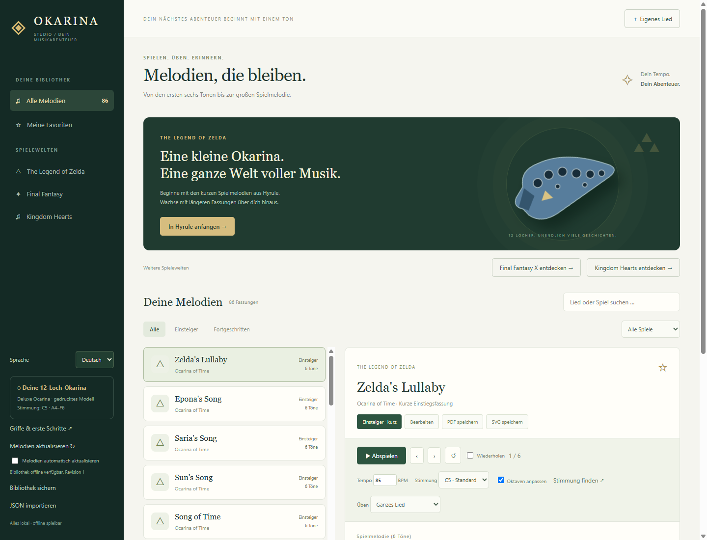
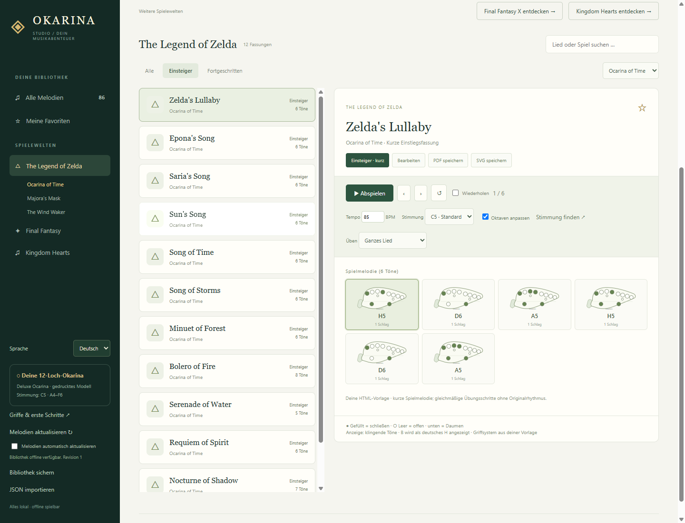
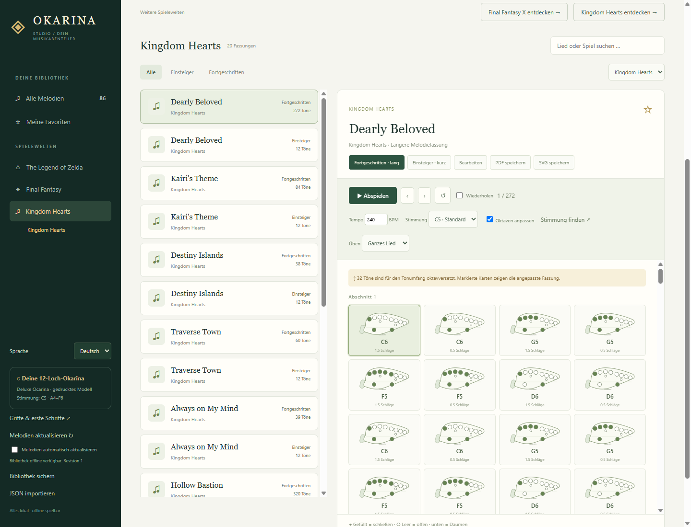
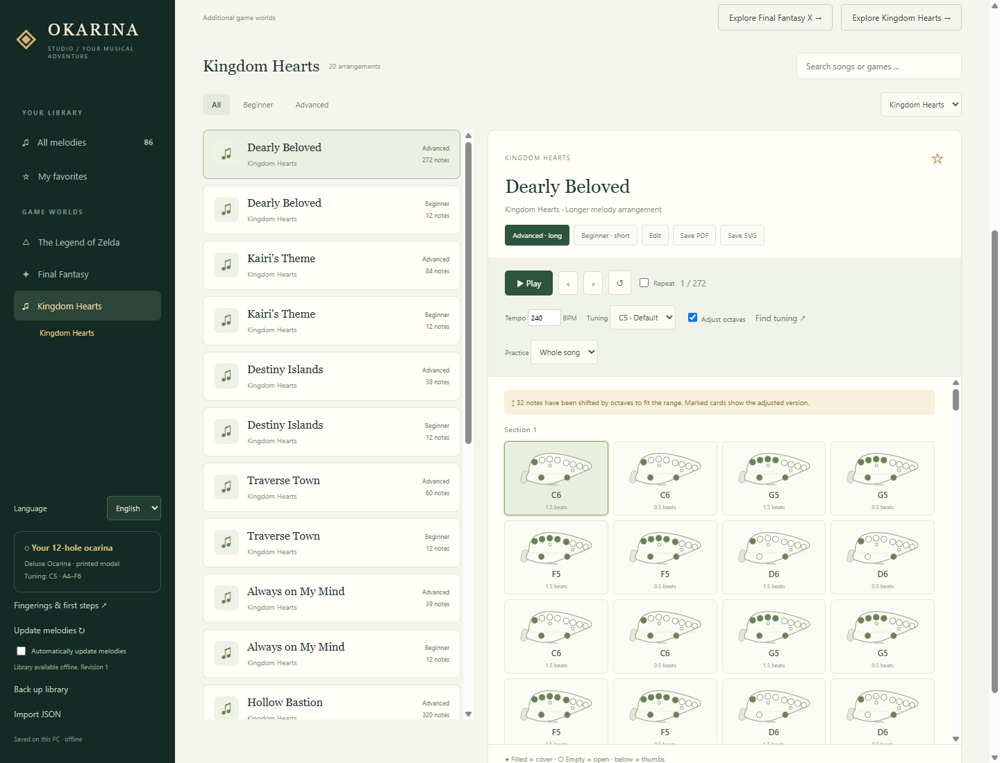

# Okarina Studio

**Lerne die Melodien aus The Legend of Zelda auf deiner echten 12-Loch-Okarina.** Von den ersten kurzen Spielmotiven aus *Ocarina of Time* bis zu längeren Melodiefassungen: Okarina Studio zeigt dir zu jedem Ton den passenden Griff und begleitet dich beim Üben.

**Zelda ist das Herzstück.** Final Fantasy und Kingdom Hearts erweitern die Bibliothek als zusätzliche Spielewelten. Die Windows-App läuft lokal und offline, mit auswählbarer Oberfläche auf **Deutsch oder Englisch**.

[Windows-Version herunterladen](https://github.com/dantezukazero/Okarina-Studio/releases/latest) · [English README](README.md) · [NFO](Okarina-Studio.nfo)

Wenn dir Okarina Studio gefällt, kannst du meine Arbeit mit einem Kaffee unterstützen:

[](https://ko-fi.com/dantezukazero)



## Von den ersten Tönen bis zur ganzen Melodie

Starte mit Zelda's Lullaby, Epona's Song, Saria's Song oder Song of Time. Höre die Töne an, schaue auf die mitlaufenden Griffbilder und übe einzelne Abschnitte in deinem eigenen Tempo. Für einige Motive stehen längere Bearbeitungen bereit, etwa Saria's Song und Song of Storms.



## Die Spielebibliothek

Version **1.2.0** enthält **86 kurze und längere Fassungen**:

| Sammlung | Spiele | Fassungen |
| --- | --- | ---: |
| **The Legend of Zelda – Hauptsammlung** | Ocarina of Time, Majora's Mask, The Wind Waker | 18 |
| Final Fantasy – Zusatzsammlung | I, VI, VII, VIII, IX, X | 48 |
| Kingdom Hearts – Zusatzsammlung | Kingdom Hearts | 20 |

**Neu: Kingdom Hearts.** Zehn Melodien gibt es jeweils als kurzen Einstieg und längere einstimmige Fassung: Dearly Beloved, Kairi's Theme, Destiny Islands, Traverse Town, Always on My Mind, Hollow Bastion, Hand in Hand, Dive into the Heart, Welcome to Wonderland und Never Land Sky.



Die Final-Fantasy-Erweiterung enthält unter anderem To Zanarkand, Suteki da ne, Besaid Island und Hymn of the Fayth aus FFX sowie Terra's Theme, Celes's Theme, Tifa's Theme, Aerith's Theme, Eyes on Me und Melodies of Life.

## Deutsch / English

Die Sprache lässt sich unten links umstellen und wird gespeichert. Auch Hilfe, Stimmgerät, Meldungen und Exporte passen sich an. Liedtitel und gespeicherte Notendaten bleiben erhalten; deutsche H-Noten werden bei englischer Anzeige als B dargestellt.



## Funktionen

Ab Version **1.3.0** kann die Melodienbibliothek unabhängig vom Programm aktualisiert werden. „Melodien aktualisieren“ prüft manuell; „Melodien automatisch aktualisieren“ aktiviert Prüfungen beim Start und alle sechs Stunden. Die Automatik ist zunächst ausgeschaltet. Eigene Lieder werden nicht hochgeladen. Neue Melodien und Korrekturen kommen aus dem öffentlichen GitHub-Katalog; persönliche Bearbeitungen und Löschungen bleiben erhalten. Eine geprüfte Fassung bleibt offline verfügbar. Details zum Veröffentlichen stehen in der [Katalog-Anleitung](library/README.md).

- Bibliothek nach Spielreihe, Spiel, Schwierigkeit, Suchbegriff und Favoriten.
- Kurze Einstiege und längere Melodiefassungen mit Griffbildern für jeden Ton.
- Hörbare Referenztöne, Abspielen mit Markierung, Tempo, einzelne Schritte und Abschnittsschleifen.
- Stimmung manuell einstellen oder mit einem Mikrofon bestimmen; Griffe werden entsprechend neu berechnet.
- Sichtbar markierte Oktavanpassung für Töne außerhalb des Instrumentenumfangs.
- Eigene Lieder mit Notenlängen und Pausen, automatische Speicherung, JSON-Import/-Export, PDF und SVG.
- Neue Bibliotheksinhalte werden beim Update ergänzt. Eigene Lieder, bearbeitete oder gelöschte Einträge, Favoriten und Einstellungen bleiben erhalten.
- Auswählbare Oberfläche auf Deutsch und Englisch, einschließlich Stimmgerätehilfe und Statusmeldungen.

## Gedruckte Okarina

Dieses Projekt entstand für eine mit einem Resin-Drucker gefertigte **„Deluxe Ocarina – Fully Playable“ von Joce's Designs**:

**[Modell und verwendetes Druckprofil auf MakerWorld](https://makerworld.com/de/models/1249288-deluxe-ocarina-fully-playable#profileId-1271476)**

Die tatsächliche Stimmung dieses Drucks ist noch nicht verifiziert. Die App erklärt unter **„Griffe & erste Schritte“**, wie man den Grundgriff spielt, den klingenden Ton misst und die passende Stimmung einstellt. Die Ausgangsgriffe stammen aus der ursprünglichen HTML-Vorlage und setzen das entsprechende 12-Loch-Griffsystem voraus.

## Starten und bauen

Mit Node.js und npm im Quellverzeichnis:

```powershell
cd OkarinaStudio
npm ci
npm start
```

Die portable Windows-Datei erzeugen:

```powershell
npm run build
```

Ergebnis: `OkarinaStudio/dist/Okarina-Studio.exe`. Per Doppelklick starten, keine Installation nötig. Die Datei wird nicht als Git-Quelldatei eingecheckt.

Mit `npm run release:package` wird nach dem Build ein vollständiges ZIP mit EXE, NFO, deutscher und englischer Anleitung sowie Prüfsummen unter `OkarinaStudio/dist/release` erstellt.

Eigene Daten liegen unter `%APPDATA%/okarina-studio/library.json`. Eine zusätzliche JSON-Sicherung lässt sich in der App anlegen. Sie enthält auch die Einstellungen. Bei einem Update die bisherige App schließen und die neue Version starten.

## Entwicklung und Prüfung

```powershell
cd OkarinaStudio
npm test
npm run test:ui
npm run build
node scripts/packaged.cjs
```

Die Tests prüfen unter anderem Transposition, Notenparser, synthetische Stimmgerätetöne, Datenmigration, Wiedergabe, Import/Export und die gepackte Windows-App. Eine Messung mit dem echten Mikrofon und dem gedruckten Instrument muss vor Ort erfolgen.

Die mitgelieferte `ui/library.js` reicht zum Starten und Bauen aus. Zum erneuten Erzeugen der Bibliothek aus den dokumentierten MIDI-Quellen dient `npm run library:prepare`. Es lädt die MIDI-Sammlung in ein lokal ignoriertes Verzeichnis; `scripts/library.cjs` dokumentiert die verwendeten Dateien, Stimmen und Oktavverschiebungen.

## Quellen und Einordnung

Die langen Fassungen sind **einstimmige Bearbeitungen ausgewählter MIDI-Stimmen**, keine vollständigen Originalpartituren. Die Okarina kann Begleitung und Mehrstimmigkeit nicht vollständig wiedergeben. Die kurzen Fassungen sind Ausschnitte zum Einsteigen; „Einsteiger“ bedeutet nicht, dass alle enthaltenen chromatischen Griffe sofort leicht sind. Quelle und Bearbeitung stehen beim jeweiligen Lied.

- Die Zelda-Spielmotive und Ausgangsgriffe stammen aus `Okarina_Editor_Tablet.html`.
- [Ocarina-of-Time-MIDI-Transkriptionen bei Classic Zelda](https://www.classiczelda.com/music/midi/zelda5/index.php).
- [Video-Game-MIDI-Sammlung von ryanrudes](https://github.com/ryanrudes/game-midis); die darin enthaltene FFX-Sammlung stammt laut Archivhinweis von Rikku's World (Stand 2002). Einzelne Urheber sind im Archiv teilweise nicht ausgewiesen.
- [Besaid Island bei Hell and Heaven Net](https://www.hellandheavennet.com/final-fantasy-10/midis.php).
- [Blasdruck und Stimmung bei Pure Ocarinas](https://pureocarinas.com/ocarina-breath-curves).

Inoffizielles Fanprojekt ohne Verbindung zu Nintendo, Square Enix oder Disney. Marken, Kompositionen und fremde Transkriptionen gehören ihren jeweiligen Rechteinhabern; für sie wird keine eigene Urheberschaft oder freie Lizenz behauptet. Die heruntergeladenen MIDI-Archive und Original-MIDI-Dateien sind nicht Bestandteil des Git-Repositories.
