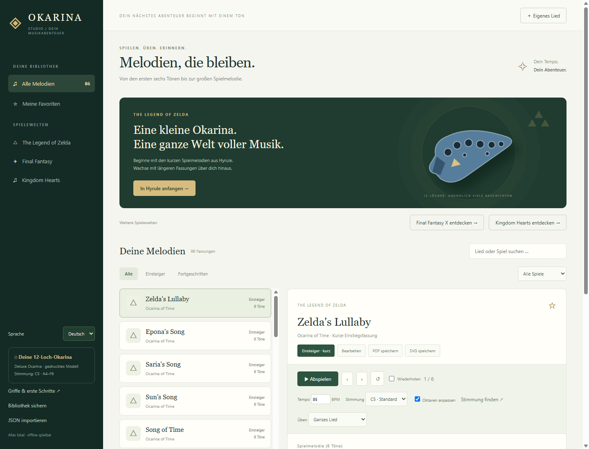
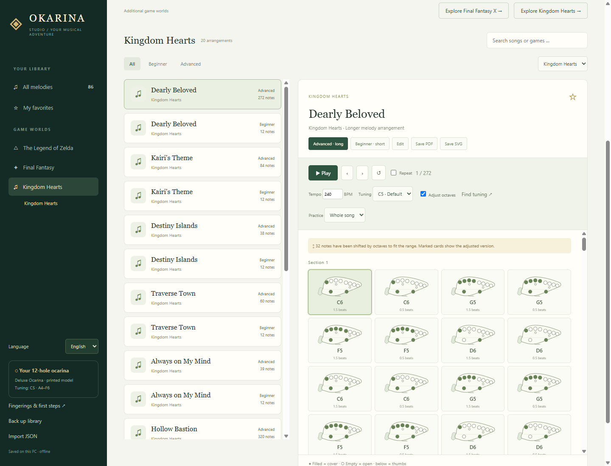

# Okarina Studio

**Learn melodies from The Legend of Zelda on your real 12-hole ocarina.** Start with the short in-game motifs from *Ocarina of Time*, then practice longer melody arrangements with a fingering diagram for every note.

**Zelda is the heart of the project.** Final Fantasy and Kingdom Hearts are additional collections. The Windows app works locally and offline, with selectable **English and German** interfaces.

[Download the Windows release](https://github.com/dantezukazero/Okarina-Studio/releases/latest) · [Deutsche README](README.md)



## Play and practice

- Follow highlighted fingering diagrams while listening to a synthesized reference melody.
- Adjust tempo, step through individual notes, repeat a section or the whole song.
- Start with short motifs; try longer single-voice arrangements when you feel ready.
- Identify your instrument's base tuning with a reference note and local microphone tuner.
- Recalculate fingerings for the selected tuning, with marked octave adjustments when needed.
- Create your own songs with durations and rests; back up as JSON and export PDF or SVG sheets.
- Switch between English and German. In English, note B uses international notation; the German interface displays it as H. Song titles and stored note data are preserved.

## Collections in version 1.2.0

| Collection | Games | Short and long arrangements |
| --- | --- | ---: |
| **The Legend of Zelda — main collection** | Ocarina of Time, Majora's Mask, The Wind Waker | 18 |
| Final Fantasy — additional collection | I, VI, VII, VIII, IX, X | 48 |
| Kingdom Hearts — additional collection | Kingdom Hearts | 20 |

New Kingdom Hearts melodies: Dearly Beloved, Kairi's Theme, Destiny Islands, Traverse Town, Always on My Mind, Hollow Bastion, Hand in Hand, Dive into the Heart, Welcome to Wonderland, and Never Land Sky. Each comes with a short introduction and a longer arrangement.



## The printed instrument

The project was created for a resin-printed **Deluxe Ocarina – Fully Playable** by Joce's Designs:

[MakerWorld model and print profile](https://makerworld.com/de/models/1249288-deluxe-ocarina-fully-playable#profileId-1271476)

Its actual tuning has not been verified. Open **Fingerings & first steps** in the app to measure the base fingering and select the appropriate tuning. The original fingering chart must match your instrument; one global tuning setting cannot correct inconsistent individual tone holes.

## Run or build

Download `Okarina-Studio.exe` from the release and double-click it. No installation is required. Close an older running version before replacing it.

To run from source on Windows with Node.js and npm:

```powershell
cd OkarinaStudio
npm ci
npm start
```

Use `npm test` and `npm run test:ui` to run the checks. Build a portable Windows executable with `npm run build`; it appears in `OkarinaStudio/dist`.

User data is stored in `%APPDATA%/okarina-studio/library.json`. Updates add new bundled songs while preserving edits, deletions, custom songs, favorites, tuning and language settings. Keep an additional JSON backup using the app.

## Sources

Longer versions are single-voice adaptations of selected MIDI tracks, not full original scores. Sources and octave changes are shown for each song. Raw MIDI files and downloaded archives are excluded from Git. See the [German documentation](README.md#quellen-und-einordnung) for the source list and regeneration instructions.

Unofficial fan project, not affiliated with Nintendo, Square Enix or Disney. Trademarks, compositions and third-party transcriptions belong to their respective rights holders; no ownership or free license is claimed for them.
