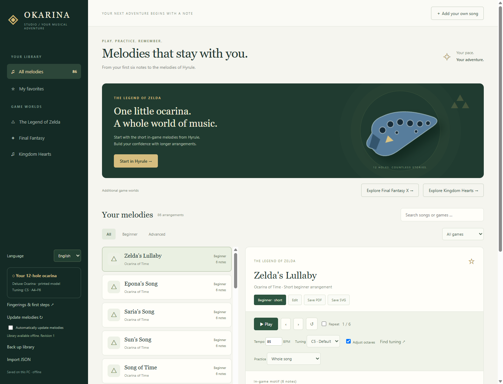
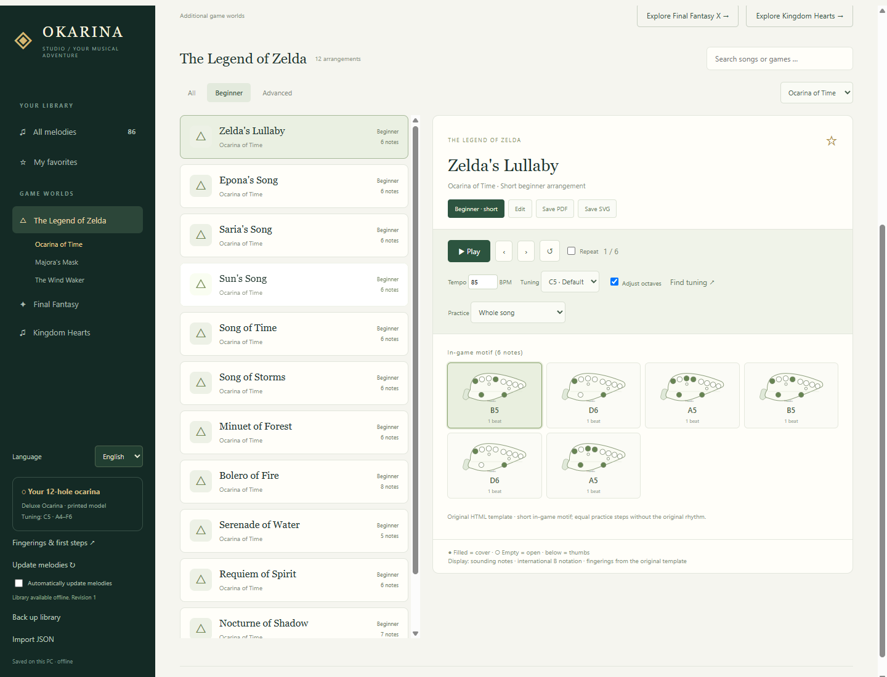
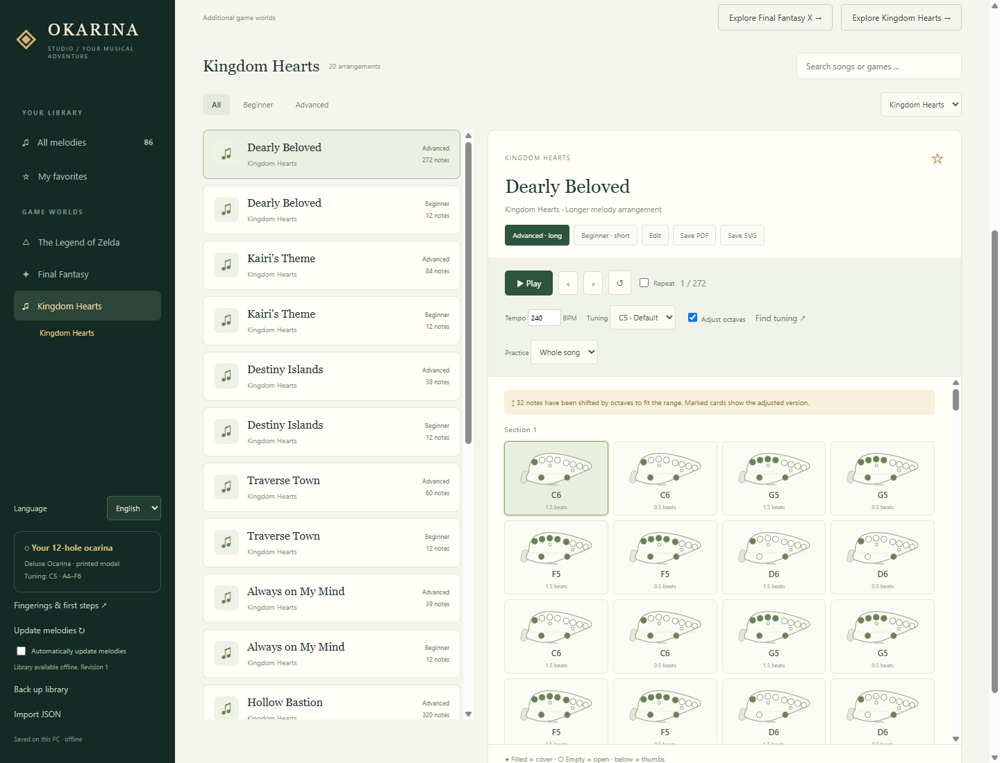

# Okarina Studio

**Learn melodies from The Legend of Zelda on your real 12-hole ocarina.** Start with the short in-game motifs from *Ocarina of Time*, then practice longer melody arrangements with a fingering diagram for every note.

**Zelda is the heart of the project.** Final Fantasy and Kingdom Hearts are additional collections. The Windows app works locally and offline, with selectable **English and German** interfaces.

[Download the Windows release](https://github.com/dantezukazero/Okarina-Studio/releases/latest) · [Deutsche README](README.de.md)

If you enjoy Okarina Studio, you can support my work with a coffee:

[](https://ko-fi.com/dantezukazero)



## From your first notes to the melodies of Hyrule

Start with Zelda's Lullaby, Epona's Song, Saria's Song or Song of Time. Listen to the notes, follow the highlighted fingerings and repeat individual sections at your own pace. Some motifs also have longer arrangements, including Saria's Song and Song of Storms.



## Play and practice

- Follow highlighted fingering diagrams while listening to a synthesized reference melody.
- Adjust tempo, step through individual notes, repeat a section or the whole song.
- Start with short motifs; try longer single-voice arrangements when you feel ready.
- Identify your instrument's base tuning with a reference note and local microphone tuner.
- Recalculate fingerings for the selected tuning, with marked octave adjustments when needed.
- Create your own songs with durations and rests; back up as JSON and export PDF or SVG sheets.
- Switch between English and German. In English, note B uses international notation; the German interface displays it as H. Song titles and stored note data are preserved.
- Update the melody library independently of the app, manually or with an optional automatic check. Personal edits are preserved.

## Library updates

Starting with **1.3.0**, new melodies and corrections can arrive without downloading another EXE. Click **Update melodies**, or enable **Automatically update melodies** for checks on startup and every six hours. Automatic checks are off by default. The app checks this project's public GitHub catalog; your own songs are never uploaded.

Verified data is cached for offline use. New songs are added, untouched originals can receive corrections, and your own edits, deletions, favorites and settings are preserved. An update backup is created before applying changes. Playback or an open editor defers application until you stop or close it and check again.

To publish new songs, export them from the app, run `npm run library:import -- "path/to/export.json"` followed by `npm run library:publish`, and push the generated catalog. See the [catalog maintenance guide](library/README.md).

## Collections in version 1.2.0

| Collection | Games | Short and long arrangements |
| --- | --- | ---: |
| **The Legend of Zelda — main collection** | Ocarina of Time, Majora's Mask, The Wind Waker | 18 |
| Final Fantasy — additional collection | I, VI, VII, VIII, IX, X | 48 |
| Kingdom Hearts — additional collection | Kingdom Hearts | 20 |

New Kingdom Hearts melodies: Dearly Beloved, Kairi's Theme, Destiny Islands, Traverse Town, Always on My Mind, Hollow Bastion, Hand in Hand, Dive into the Heart, Welcome to Wonderland, and Never Land Sky. Each comes with a short introduction and a longer arrangement.

The Final Fantasy collection includes To Zanarkand, Suteki da ne, Besaid Island and Hymn of the Fayth from FFX, as well as Terra's Theme, Celes's Theme, Tifa's Theme, Aerith's Theme, Eyes on Me and Melodies of Life.



## The printed instrument

The project was created for a resin-printed **Deluxe Ocarina – Fully Playable** by Joce's Designs:

[MakerWorld model and print profile](https://makerworld.com/de/models/1249288-deluxe-ocarina-fully-playable#profileId-1271476)

Its actual tuning has not been verified. Open **Fingerings & first steps** in the app to measure the base fingering and select the appropriate tuning. The original fingering chart must match your instrument; one global tuning setting cannot correct inconsistent individual tone holes.

## Run or build

Download `Okarina-Studio.exe` from the release and double-click it. No installation is required. Close an older running version before replacing it.

To run from source on Windows with Node.js and npm:

```powershell
cd OkarinaStudio
npm ci
npm start
```

Use `npm test` and `npm run test:ui` to run the checks. Build a portable Windows executable with `npm run build`; it appears in `OkarinaStudio/dist`.

After building, run `npm run release:package` to create a complete ZIP with the executable, NFO, German and English instructions, and checksums in `OkarinaStudio/dist/release`.

User data is stored in `%APPDATA%/okarina-studio/library.json`. Updates add new bundled songs while preserving edits, deletions, custom songs, favorites, tuning and language settings. Keep an additional JSON backup using the app.

## Development and verification

```powershell
cd OkarinaStudio
npm test
npm run test:ui
npm run build
node scripts/packaged.cjs
```

Checks cover transposition, note parsing, synthetic tuner signals, library migration, language switching and persistence, playback, import/export, and the packaged Windows application. The real microphone and printed instrument must be checked locally.

The checked-in `ui/library.js` is sufficient to run and build the app. To regenerate the collection from the documented MIDI sources, use `npm run library:prepare`. Downloads remain in a locally ignored directory. `scripts/library.cjs` records the selected files, melody tracks and octave shifts.

## Sources

Longer versions are **single-voice adaptations of selected MIDI tracks**, not full original scores. One ocarina cannot reproduce all accompaniment and harmony. Beginner versions are short excerpts; the label does not mean every chromatic fingering is immediately easy. Sources and octave changes are shown for each song.

- The original Zelda motifs and fingering chart come from `Okarina_Editor_Tablet.html`.
- [Ocarina of Time MIDI transcriptions at Classic Zelda](https://www.classiczelda.com/music/midi/zelda5/index.php).
- [Video game MIDI collection by ryanrudes](https://github.com/ryanrudes/game-midis). Its FFX archive credits Rikku's World (2002); individual transcription authors are not always identified.
- [Besaid Island at Hell and Heaven Net](https://www.hellandheavennet.com/final-fantasy-10/midis.php).
- [Breath pressure and tuning explained by Pure Ocarinas](https://pureocarinas.com/ocarina-breath-curves).

Raw MIDI files and downloaded archives are excluded from Git.

Unofficial fan project, not affiliated with Nintendo, Square Enix or Disney. Trademarks, compositions and third-party transcriptions belong to their respective rights holders; no ownership or free license is claimed for them.
